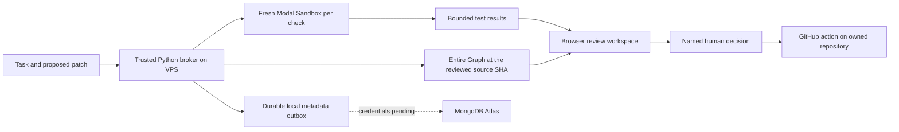

# PR Trailer

Review what an AI-written change does, inspect the tests and let a named human decide whether it reaches the repository.

[Open PR Trailer](https://pr-trailer.vercel.app) · [Review workspace](https://pr-trailer.vercel.app/workspace) · [Measured results](docs/RESULTS.md)

Built by Shreyansh, team The CS Guy, for Junction 2026's Tieto Earned Trust in AI Code challenge.

## The review loop

Open a task, inspect its implementation and behavioural evidence, then ask for changes, block or merge. Fixed tests check the requested behaviour. The reviewer can see a small set of important lines beside the evidence instead of treating a long patch as a model's assurance.

AI writes code. It does not perform runtime review or grant merge approval. A named human merges through their own GitHub account. In the owned bank repository, merge and return actions make real GitHub changes. Blocking labels the PR and posts one reviewer question; reset removes the corresponding comment. Outside public repositories use a read-only patch path.

## How the current product works



The [cloud integration canary](https://pr-trailer-sponsors.72.61.22.106.sslip.io) runs the broker on an existing VPS and executes tests in Modal. It does not depend on the builder's Mac. Its write actions target an isolated owned bank repository. `/build.json` identifies its exact application release.

The original Vercel URL still routes to the older Mac-hosted worker until the cloud release passes the full desktop and phone acceptance test and independent review. The original repository and public route have not been replaced by this feature branch.

## Sponsor use

| Service | Implemented role and evidence |
| --- | --- |
| Codex | Used to build, revise and verify the product. The runtime does not ask Codex to approve a merge. |
| CRACI | Real `runs-on: craci` workflow runs Python and JavaScript regression checks. [Successful run](https://github.com/13shreyansh/pr-trailer/actions/runs/43685139962). |
| Modal | Actual fresh Sandboxes execute fixed request tests, removal trials, necessity controls and held-out checks. Each report records its Sandbox ID, wrapper digest, bounded output, exit status and original time. [Real provider receipt](evidence/sponsor-live-verification.json). |
| Entire Graph | Runs against the actual reviewed checkout and ask, pinned to its source SHA. The Code context link shows graph evidence with source links. The official local Graph binary needs no hosted account. This integration does not capture Entire Sessions. |
| MongoDB Atlas | Adapter, idempotent execution/review-event metadata and durable local outbox are implemented. Provider credential configuration and remote write/read verification remain pending. No live Atlas usage or qualification is claimed. |

### What Modal can access

The trusted broker owns GitHub credentials. Sandboxes receive a bounded source archive, fixed tests and the command to run. They receive no broker secrets and cannot access the network. The source tree is read-only to the test user. The wrapper bounds CPU, duration, output and filesystem reads, rejects nonregular result files, and terminates each Sandbox after its check. A provider failure is shown as a failed run, with no silent local fallback.

Completed reports can be reused only when a producer-written contract matches the source/base SHA, ask, case, changed paths, effective test invocation, held-out invocation and execution profile. Reused evidence displays its original measurement time and source; it is not a newly timed execution. Explicit Re-run tests, inbox Run again and its T shortcut always request fresh provider execution. Legacy reports without that producer contract are declined.

### What the log store retains

Execution and acknowledged merge, return, block, unblock and revert events contain PR/run identifiers, commit hashes, counts, digests and provider metadata. They exclude raw source, test output, reviewer free text and credentials. An idempotent local SQLite outbox retries Atlas delivery. A pending event is never reported as stored remotely. Atlas must be configured and tested before this can be described as a live remote archive.

## Inspect locally

Use Node.js 24 and Python 3.12. Install JavaScript dependencies with `npm ci`; Python dependencies are listed in `app/requirements.txt`.

```bash
python3.12 -m venv .venv312
.venv312/bin/python -m pip install -r app/requirements.txt
npm ci
.venv312/bin/python -m product.server
```

The worker listens on `127.0.0.1:4322`. GitHub write paths require the owner's configured broker/authentication and an explicitly chosen owned repository. Do not point write tests at unrelated projects. Starting the worker alone does not configure frontend routing or GitHub access.

`app/dev.js` is a legacy fixed-sample frontend server, not a complete launcher for the current workspace APIs. A current frontend needs its API routes proxied to the worker. The repository does not yet provide a verified one-command full-stack setup; the deployed workspace is the working review entry point.

## Check a change

```bash
npm test
.venv312/bin/python -m unittest discover -s tests -v
```

Use an isolated owned test repository for merge, return and block acceptance checks. Verify the actual GitHub result and clean up only the test artefacts you created. Browser screenshots need loaded test results and review content, not a skeleton screen.

## Evidence and known failures

The recorded experiment reduced 5,741 implementation lines across 23 PRs to 25 selected review lines. This is a measured presentation reduction, not measured time saved or proof of safety. On one recorded request set, the implementation needed 7 of 37 changed lines and passed 9 of 9 request tests while held-out checks still found failures.

Two important failures remain in the evidence: a retained cap is not wired into the transfer path, and a half-cent rounding case fails. Review bots also caught both issues. Do not attribute those discoveries solely to PR Trailer or claim passing request tests establish correctness.

The bank is synthetic. Public Reduino/GPL examples and AI-generated development records require their original attribution and licence treatment. See [docs/RESULTS.md](docs/RESULTS.md), [docs/MEASURE-REVIEW.md](docs/MEASURE-REVIEW.md) and [DECISIONS.md](DECISIONS.md).

## Cloud operation

The trusted broker reads encrypted systemd credentials into memory. Persistent credentials are stored only as host-key-encrypted ciphertext. Do not create plaintext environment files or put credential values in command arguments.

`TIETO_TEST_RUNNER=modal` selects real Modal execution. `ENTIRE_GRAPH_BIN` points to the checksum-verified Graph binary. `TIETO_STATE_DIR` and `TIETO_WORKSPACE_CONFIG` isolate product state and the owned test repository. The optional `MONGODB_URI` and `MONGODB_DATABASE` enable remote metadata delivery after configuration. Provider credentials stay with the broker and are never forwarded to Modal.

`python scripts/product/stage_cloud.py` stages an exact committed archive on this entry's VPS. Deployment is separate from release to the public Vercel route. Run the deployed acceptance against the isolated canary and inspect real GitHub receipts before promotion.

## Code map

`product/server.py` handles the worker API. `product/service.py`, `product/sandbox.py` and `product/github.py` coordinate runs and repository actions. `app/` contains the browser interface. `tests/` and `scripts/product/` hold checks. Older story scripts and pitch notes may describe earlier prototypes; use the current review workflow and disclose the hosting limits above.
