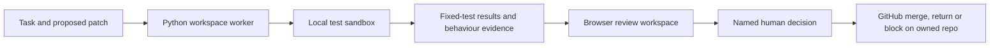
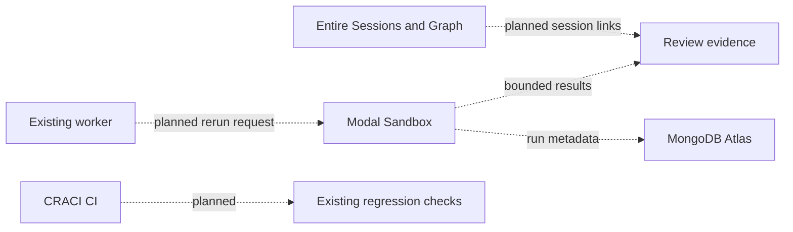

# PR Trailer

Review what an AI-written change does, inspect the tests and let a named human decide whether it reaches the repository.

[Open PR Trailer](https://pr-trailer.vercel.app) · [Review workspace](https://pr-trailer.vercel.app/workspace) · [Measured results](docs/RESULTS.md)

Built by Shreyansh, team The CS Guy, for Junction 2026's Tieto Earned Trust in AI Code challenge.

## The review loop

Open a task, inspect its implementation and behavioural evidence, then ask for changes, block or merge. Fixed tests check the requested behaviour. The reviewer can see a small set of important lines beside the evidence instead of treating a long patch as a model's assurance.

AI writes code. It does not perform runtime review or grant merge approval. A named human merges through their own GitHub account. In the owned bank repository, merge and return actions make real GitHub changes. Blocking labels the PR and posts one reviewer question; reset removes the corresponding comment. Outside public repositories use a read-only patch path.

## How the current product works



The frontend is on Vercel. The current interactive Python worker runs on the builder's Mac through a Cloudflare quick tunnel. Keep that machine awake and online while using this deployment. This is a material hosting limitation; Modal is not running it today.

The documented live behaviour includes application changes newer than the published application snapshot at the time of this README update. This documentation-only publication does not publish those pending application commits. Some local behaviour may therefore differ from the live workspace.

## Sponsor use

| Service | Status and role |
| --- | --- |
| Codex | Used during development to build, revise and verify the review product. The runtime does not ask Codex to approve a merge. |
| CRACI | **Planned, not implemented.** Run the existing Python and JavaScript checks on CRACI CI. |
| Modal | **Planned, not implemented.** Execute isolated test reruns in Modal Sandboxes and return bounded logs and exit status. This does not yet remove the Mac-hosted worker. |
| MongoDB Atlas | **Planned, not implemented.** Retain execution metadata and review-event logs with run and PR identifiers. |
| Entire | **Planned, not implemented.** Use Entire Sessions/Graph to connect coding-session evidence to the change under review. An Entire account is still needed. |

Draft prize registration is not evidence that these planned services already work.

## Inspect locally

Use Node.js 24 and Python 3.12. Install JavaScript dependencies with `npm ci`; Python dependencies are listed in `app/requirements.txt`.

```bash
python3.12 -m venv .venv312
.venv312/bin/python -m pip install -r app/requirements.txt
npm ci
.venv312/bin/python -m product.server
```

The worker listens on `127.0.0.1:4322`. GitHub write paths require the owner's configured broker/authentication and an explicitly chosen owned repository. Do not point write tests at unrelated projects. Starting the worker alone does not configure frontend routing or GitHub access.

`app/dev.js` is a legacy fixed-sample frontend server, not a complete launcher for the current workspace APIs. A current frontend needs its API routes proxied to the worker. The repository does not yet provide a verified one-command full-stack setup; the deployed workspace is the working review entry point.

## Check a change

```bash
npm test
.venv312/bin/python -m unittest discover -s tests -v
```

Use an isolated owned test repository for merge, return and block acceptance checks. Verify the actual GitHub result and clean up only the test artefacts you created. Browser screenshots need loaded test results and review content, not a skeleton screen.

## Evidence and known failures

The recorded experiment reduced 5,741 implementation lines across 23 PRs to 25 selected review lines. This is a measured presentation reduction, not measured time saved or proof of safety. On one recorded request set, the implementation needed 7 of 37 changed lines and passed 9 of 9 request tests while held-out checks still found failures.

Two important failures remain in the evidence: a retained cap is not wired into the transfer path, and a half-cent rounding case fails. Review bots also caught both issues. Do not attribute those discoveries solely to PR Trailer or claim passing request tests establish correctness.

The bank is synthetic. Public Reduino/GPL examples and AI-generated development records require their original attribution and licence treatment. See [docs/RESULTS.md](docs/RESULTS.md), [docs/MEASURE-REVIEW.md](docs/MEASURE-REVIEW.md) and [DECISIONS.md](DECISIONS.md).

## Planned execution and provenance



After implementation approval, Modal needs a real sandbox run, timeout handling and a rerun against a frozen case. Atlas needs a retained run log that can be retrieved after restart without storing credentials or private source text by default. Entire needs an account and a real session/graph link that helps explain a reviewed change. CRACI needs a successful `runs-on: craci` job. None of these receipts exists for the planned integrations today.

## Code map

`product/server.py` handles the worker API. `product/service.py`, `product/sandbox.py` and `product/github.py` coordinate runs and repository actions. `app/` contains the browser interface. `tests/` and `scripts/product/` hold checks. Older story scripts and pitch notes may describe earlier prototypes; use the current review workflow and disclose the hosting limits above.
